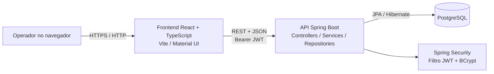
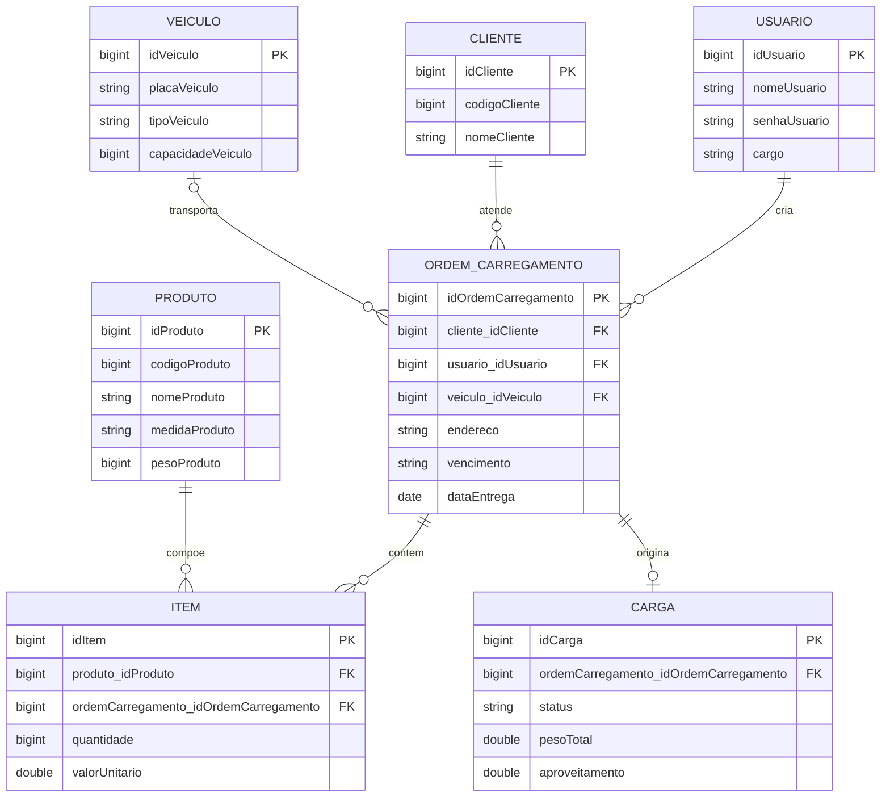
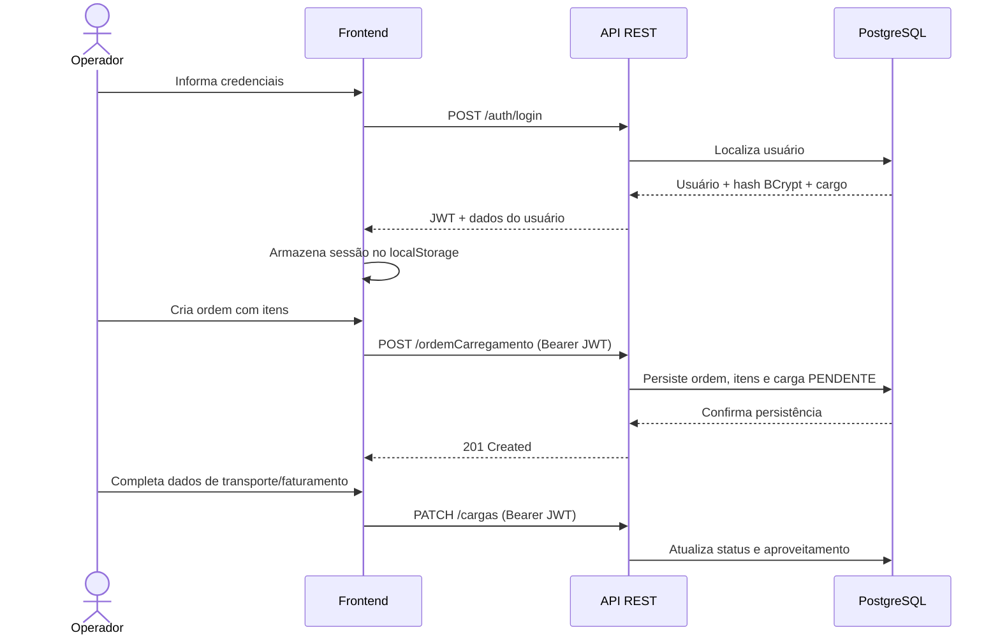

# LogSensei

> Sistema web para apoiar a operação logística, do cadastro de clientes e produtos ao acompanhamento de ordens de carregamento e cargas.


## Sumário

- [Visão geral](#visão-geral)
- [Funcionalidades e casos de uso](#funcionalidades-e-casos-de-uso)
- [Arquitetura](#arquitetura)
- [Modelo de domínio](#modelo-de-domínio)
- [Perfis de acesso](#perfis-de-acesso)
- [Pré-requisitos](#pré-requisitos)
- [Configuração e execução local](#configuração-e-execução-local)
- [Primeiro usuário e primeiro acesso](#primeiro-usuário-e-primeiro-acesso)
- [API](#api)
- [Fluxo operacional](#fluxo-operacional)
- [Estrutura do projeto](#estrutura-do-projeto)
- [Segurança e configuração](#segurança-e-configuração)
- [Observações técnicas](#observações-técnicas)

## Visão geral

O LogSensei é uma aplicação de gestão logística composta por uma interface web e uma API REST. O sistema permite registrar dados mestres (clientes, produtos e veículos), criar ordens de carregamento com itens e acompanhar o ciclo de vida das cargas. O acesso é autenticado por usuário e senha, com emissão de token JWT.

## Funcionalidades e casos de uso

| Área | Casos de uso disponíveis |
| --- | --- |
| Autenticação | Entrar com usuário e senha; receber token JWT para as chamadas autenticadas. |
| Usuários | Cadastrar usuário, listar usuários, consultar cargos existentes e usuários com cargo `FILIAL`. |
| Clientes | Cadastrar e listar clientes; localizar por código. |
| Produtos | Cadastrar e listar produtos; localizar por código. |
| Veículos | Cadastrar e listar veículos; localizar por placa. |
| Ordens | Criar ordem para um cliente com endereço, vencimento, observação e itens de produtos. |
| Cargas | Listar, atualizar dados logísticos, cancelar (perfis autorizados) e consultar cargas associadas a uma filial. |
| Diário da filial | Consultar cargas vinculadas ao usuário de filial autenticado na interface. |

Ao criar uma ordem, a API calcula o peso total a partir do peso cadastrado de cada produto multiplicado pela quantidade, cria uma carga associada e inicia o status como `PENDENTE`.

## Arquitetura



O frontend concentra as telas e a navegação; os serviços em `front-end/src/services` fazem as chamadas HTTP via Axios. A API segue separação por camadas: controllers recebem requisições, services executam regras de negócio e repositories acessam as entidades via Spring Data JPA. O banco persistente é PostgreSQL.

### Tecnologias

- **Frontend:** React 19, TypeScript, Vite, React Router, Material UI e Axios.
- **Backend:** Java 21, Spring Boot 4, Spring Web MVC, Spring Security, Spring Data JPA, Bean Validation e Lombok.
- **Persistência:** PostgreSQL com Hibernate/JPA.
- **Autenticação:** JWT (JJWT) e senhas codificadas com BCrypt.

## Modelo de domínio



Os nomes físicos de colunas e chaves estrangeiras são gerados pelo Hibernate a partir do mapeamento JPA e da estratégia de nomenclatura configurada no ambiente.

## Perfis de acesso

Os cargos são armazenados como texto na coluna `usuario.cargo`. Os valores reconhecidos pela interface e por algumas regras atuais são:

| Cargo | Acesso observado no sistema |
| --- | --- |
| `GERENTE LOGISTICA` | Cadastros, cargas, ordens e gestão de usuários; pode cancelar cargas. |
| `DESENVOLVEDOR` | Acesso equivalente ao gerente nas regras implementadas; pode cadastrar usuários e cancelar cargas. |
| `ANALISTA` | Cadastros, cargas e ordens. |
| `FILIAL` | Ordens e diário/consulta de cargas da filial. |

Use os valores exatamente como escritos, em maiúsculas. O controle de navegação por cargo está implementado no frontend; as rotas da API exigem autenticação JWT, mas não há autorização por cargo aplicada globalmente no Spring Security. Algumas regras de negócio validam o cargo no service. Considere esse comportamento ao publicar o serviço e restrinja as permissões da API conforme o modelo de segurança desejado.

## Pré-requisitos

- Java 21.
- Node.js compatível com Vite 8 e npm.
- PostgreSQL acessível.
- Uma base de dados criada para a aplicação.

## Configuração e execução local

### 1. Configure o banco

Crie uma base no PostgreSQL, por exemplo:

```sql
CREATE DATABASE logsensei;
```

O repositório não inclui `application.properties` nem migrações/schema versionados. Configure a conexão e a estratégia de criação/atualização das tabelas na configuração local do Spring Boot, ou forneça essas propriedades por variáveis de ambiente/argumentos de execução. Os nomes esperados pelo Hibernate podem variar conforme a configuração adotada; confira o schema efetivamente criado antes de executar SQL manual.

No mínimo, configure URL JDBC, usuário e senha do PostgreSQL e `JWT_SECRET`. O segredo JWT deve ser aleatório e forte, com pelo menos 32 bytes para HMAC-SHA. Não reutilize o exemplo de segredo em produção.

Exemplo de variáveis para uma sessão local (ajuste credenciais e URL):

```powershell
$env:SPRING_DATASOURCE_URL = "jdbc:postgresql://localhost:5432/logsensei"
$env:SPRING_DATASOURCE_USERNAME = "postgres"
$env:SPRING_DATASOURCE_PASSWORD = "sua_senha_local"
$env:JWT_SECRET = "substitua_por_uma_chave_aleatoria_com_mais_de_32_bytes"
```

> Essas variáveis são consumidas pelo Spring Boot quando as propriedades de conexão usam os nomes convencionais `spring.datasource.*`. O projeto declara `JWT_SECRET` diretamente no serviço JWT. Defina também `spring.jpa.hibernate.ddl-auto` de acordo com seu ambiente; não use criação destrutiva em um banco com dados importantes.

### 2. Inicie a API

No PowerShell, a partir da raiz do repositório:

```powershell
cd back-end
.\mvnw.cmd spring-boot:run
```

A API iniciará na porta padrão do Spring Boot, `8080`, salvo configuração diferente.

### 3. Inicie a interface

Em outro terminal:

```powershell
cd front-end
npm install
npm run dev
```

O Vite disponibiliza a aplicação normalmente em `http://localhost:5173`. A origem local já está liberada na configuração CORS da API.

> **URL da API no frontend:** `front-end/src/services/api.ts` Para desenvolvimento local, altere a `baseURL` para `http://localhost:8080/` ou adapte o serviço para usar variável de ambiente antes de executar localmente.

### Scripts disponíveis

| Diretório | Comando | Finalidade |
| --- | --- | --- |
| `front-end` | `npm run dev` | Inicia o servidor de desenvolvimento Vite. |
| `front-end` | `npm run build` | Verifica os tipos TypeScript e gera o build de produção. |
| `front-end` | `npm run lint` | Executa o ESLint. |
| `front-end` | `npm run preview` | Serve localmente o build do Vite. |
| `back-end` | `./mvnw spring-boot:run` | Inicia a API com Maven Wrapper. |
| `back-end` | `./mvnw test` | Executa os testes do backend. |

No Windows, use `mvnw.cmd` em vez de `./mvnw`.

## Primeiro usuário e primeiro acesso

A API protege todas as rotas exceto `/auth/**`; portanto, o primeiro usuário precisa ser inserido diretamente no banco. A aplicação compara a senha informada no login com um hash BCrypt armazenado. **Não grave a senha em texto puro.**

### 1. Gere um hash BCrypt

O projeto já possui a classe `com.logsensei.LogSensei.config.GerarSenha`, mas ela contém uma senha fixa de exemplo. Não use essa senha em produção. Altere o valor localmente para uma senha temporária forte e execute a classe para imprimir o hash BCrypt:

```powershell
cd back-end
.\mvnw.cmd -q -DskipTests compile
```

Depois execute `GerarSenha` pela sua IDE (classe principal: `com.logsensei.LogSensei.config.GerarSenha`) ou use um gerador BCrypt confiável. Copie o hash impresso e não compartilhe nem versione a senha ou o hash de credenciais reais.

### 2. Confira o schema e insira o usuário inicial

A entidade mapeia a tabela `usuario` e os campos `nomeUsuario`, `senhaUsuario` e `cargo`, mas o repositório não versiona migrações nem DDL. Com Hibernate usando a estratégia padrão de nomenclatura Spring, os nomes de coluna costumam ser `nome_usuario`, `senha_usuario` e `cargo`; confirme no banco antes de usar. Se sua tabela usar nomes camelCase com aspas, adapte os identificadores ao schema real.

Exemplo para o schema snake_case padrão, substituindo o hash pelo resultado BCrypt:

```sql
INSERT INTO usuario (nome_usuario, senha_usuario, cargo)
VALUES (
  'admin',
  '$2a$10$SUBSTITUA_PELO_HASH_BCRYPT_GERADO',
  'DESENVOLVEDOR'
);
```

O `idUsuario` é gerado pelo banco (`IDENTITY`), então não precisa ser informado. O cargo `DESENVOLVEDOR` é aceito pelas regras de cadastro de usuários e cancelamento de carga, e tem acesso às telas administrativas no frontend. Para o primeiro usuário, esse é o perfil de bootstrap mais abrangente observado no código.

Confirme a inserção sem expor o hash em logs ou capturas de tela:

```sql
SELECT id_usuario, nome_usuario, cargo
FROM usuario
WHERE nome_usuario = 'admin';
```

### 3. Faça login

Acesse a tela de login e use o nome e a senha originais (não o hash). A API emite um JWT com validade de 8 horas. A interface guarda token, ID, nome e cargo no `localStorage` do navegador e envia `Authorization: Bearer <token>` nas requisições.

### 4. Cadastre outros usuários pela aplicação

O endpoint de cadastro exige o parâmetro `idUsuario` do usuário que está cadastrando. A senha de novos usuários é codificada com BCrypt pelo backend.

```http
POST /usuarios?idUsuario=1
Authorization: Bearer <token>
Content-Type: application/json
```

```json
{
  "nomeUsuario": "filial-centro",
  "senhaUsuario": "troque-esta-senha",
  "cargo": "FILIAL"
}
```

Os cargos conhecidos pela interface são `GERENTE LOGISTICA`, `DESENVOLVEDOR`, `ANALISTA` e `FILIAL`.

## API

A base local padrão é `http://localhost:8080`. Todas as rotas abaixo, exceto login e preflight CORS, exigem `Authorization: Bearer <token>`.

| Método | Rota | Descrição |
| --- | --- | --- |
| `POST` | `/auth/login` | Autentica e devolve token, ID, nome e cargo. |
| `POST` | `/usuarios?idUsuario={id}` | Cadastra usuário (cargo autorizado pelo service). |
| `GET` | `/usuarios` | Lista usuários. |
| `GET` | `/usuarios/cargos` | Lista cargos distintos cadastrados. |
| `GET` | `/usuarios/filiais` | Lista nomes de usuários com cargo `FILIAL`. |
| `POST` | `/clientes` | Cadastra cliente. |
| `GET` | `/clientes` | Lista clientes. |
| `GET` | `/clientes/codigo/{codigoCliente}` | Busca cliente pelo código. |
| `POST` | `/produtos` | Cadastra produto. |
| `GET` | `/produtos` | Lista produtos. |
| `GET` | `/produtos/codigo/{codigoProduto}` | Busca produto pelo código. |
| `POST` | `/veiculos` | Cadastra veículo. |
| `GET` | `/veiculos` | Lista veículos. |
| `GET` | `/veiculos/placa/{placaVeiculo}` | Busca veículo pela placa. |
| `POST` | `/ordemCarregamento` | Cria uma ordem e a carga inicial correspondente. |
| `GET` | `/cargas` | Lista cargas. |
| `PATCH` | `/cargas` | Atualiza dados da carga e da ordem associada. |
| `PATCH` | `/cargas/{id}/cancelar?idUsuario={idUsuario}` | Cancela uma carga (gerente ou desenvolvedor). |
| `GET` | `/cargas/filial?idUsuario={idUsuario}` | Consulta cargas para o usuário com cargo `FILIAL`. |

Exemplo de autenticação:

```http
POST /auth/login
Content-Type: application/json
```

```json
{
  "nomeUsuario": "admin",
  "senhaUsuario": "sua-senha"
}
```

## Fluxo operacional



## Estrutura do projeto

```text
LogSensei/
├── back-end/
│   ├── pom.xml
│   └── src/main/java/com/logsensei/LogSensei/
│       ├── config/       # JWT, segurança e codificação de senha
│       ├── controller/   # Endpoints REST
│       ├── dto/          # Contratos de entrada e saída
│       ├── model/        # Entidades JPA
│       ├── repository/   # Acesso a dados
│       └── service/      # Regras de negócio
└── front-end/
    ├── package.json
    └── src/
        ├── components/   # Componentes de interface
        ├── pages/        # Telas e fluxos
        ├── routes/       # Rotas protegidas por perfil/token
        ├── services/     # Cliente HTTP e integração com API
        └── types/        # Tipos TypeScript
```

## Segurança e configuração

- O login público está em `POST /auth/login`; as demais rotas da API requerem JWT válido.
- Os tokens são assinados com `JWT_SECRET` e expiram após 8 horas.
- Senhas são armazenadas com BCrypt pelo fluxo de cadastro.
- CORS está configurado para `http://localhost:5173`; ajuste as origens ao implantar em outro domínio.
- O frontend atualmente persiste o token em `localStorage`. Em produção, avalie o modelo de armazenamento de sessão adequado à sua política de segurança.

## Observações técnicas

- O repositório não inclui configuração versionada do datasource, migrações do banco, arquivo de ambiente de exemplo ou contrato OpenAPI.
- O serviço JWT espera a variável `JWT_SECRET`; sem ela, ou com uma chave muito curta, a API não consegue inicializar corretamente.
- A autorização por cargo ocorre parcialmente na interface e em regras específicas do backend. A interface, isoladamente, não deve ser considerada uma barreira de segurança.
- O status calculado ao atualizar a carga depende de motorista, veículo e local de saída; com nota fiscal preenchida, uma carga pronta passa a `ENTREGUE`. O status inicial é `PENDENTE` e o cancelamento define `CANCELADA`.

---

<p align="center">LogSensei · Gestão logística</p>